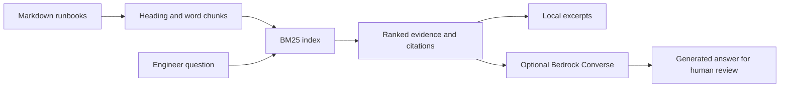

# Runbook AI Assistant

Find relevant Kubernetes and AWS troubleshooting instructions, cite their sources, and optionally generate an answer with Amazon Bedrock.

**Status:** runnable portfolio project. Local retrieval and mocked Bedrock behavior are tested. Live AWS inference has not been verified. No cloud resources are created by this project.

## Why this exists

An on-call engineer needs a traceable starting point during an incident. This project ranks small Markdown runbooks with BM25 and returns source sections. Optional Bedrock generation adds natural-language synthesis using the retrieved evidence.

## Try it in one minute

Requires Python 3.11 or later. Local mode has no dependencies, credentials, or API charges.

```bash
python runbook.py 'How do I investigate CrashLoopBackOff?'
python runbook.py 'S3 AccessDenied KMS' --top-k 2
python -m unittest discover -s tests -v
python evaluate.py
```

The JSON response contains `mode`, `answer`, and ranked `sources`. Local mode quotes retrieved text; it does **not** call an LLM. An unrelated query such as `zyxwvu` returns an explicit no-match response.



## Optional AWS AI mode

Install `requirements-cloud.txt`, authenticate using an AWS profile or workload role, and choose a Converse-compatible model available in your region. Supply a model ID supported by your account; none is assumed or hardcoded.

```bash
python -m pip install -r requirements-cloud.txt
AWS_PROFILE=portfolio python runbook.py 'S3 AccessDenied KMS' \
  --bedrock-model YOUR_MODEL_ID --region us-east-1
```

The caller needs `bedrock:InvokeModel` scoped to the selected model. Inference profiles can require additional model ARNs. This command sends the question and retrieved runbook excerpts to AWS and incurs model charges. Use the supplied synthetic runbooks for a demo.

## Engineering decisions

| Decision | Reason | Tradeoff |
| --- | --- | --- |
| BM25 before embeddings | Inspectable ranking, zero-cost local demo | Cannot reliably match synonyms |
| Chunks of at most 180 words | Bounds each evidence block | Long procedures may span chunks |
| Stable tie ordering | Reproducible examples and tests | No personalization |
| No-match abstention | Avoid unnecessary generation without lexical evidence | A positive lexical match is not proof of relevance |
| No command execution | Keeps diagnosis under operator control | Engineer performs all remediation |

The system prompt requests evidence citations and treats documents as untrusted. This is a mitigation, not a guarantee against prompt injection or hallucination. Generated citations are not programmatically verified. The tiny six-query regression set uses synthetic, keyword-oriented questions and is not evidence of general retrieval quality.

## Docker

```bash
docker build -t runbook-ai .
docker run --rm runbook-ai 'Why is my pod Pending?'
```

The image runs local retrieval as a non-root user. Optional Bedrock dependencies are intentionally absent from the image.

## Demonstrate in an interview

1. Show a successful Kubernetes query and its source section.
2. Show an unrelated query and explain abstention.
3. Run the evaluation, then try a paraphrase with no shared keywords and discuss failure.
4. Explain when you would add embeddings, access controls, and a larger labeled evaluation set.

Next extensions: hybrid semantic retrieval, document access filters, verified citations, latency/token telemetry, and a human-reviewed incident evaluation set. This demo does not claim production reliability or measured incident-time savings.

## References

- [AWS Bedrock Converse](https://docs.aws.amazon.com/bedrock/latest/userguide/conversation-inference.html)
- [Boto3 Converse request format](https://docs.aws.amazon.com/boto3/latest/reference/services/bedrock-runtime/client/converse.html)
